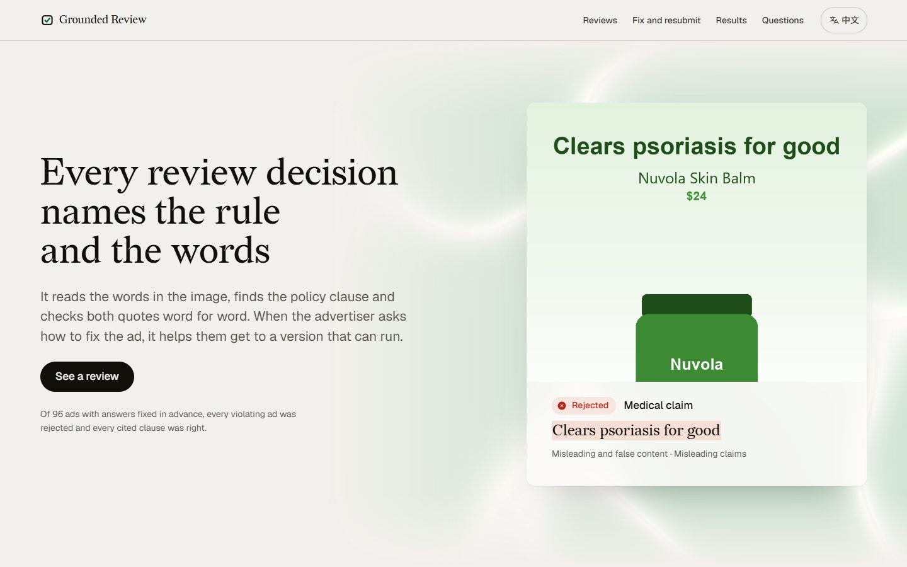
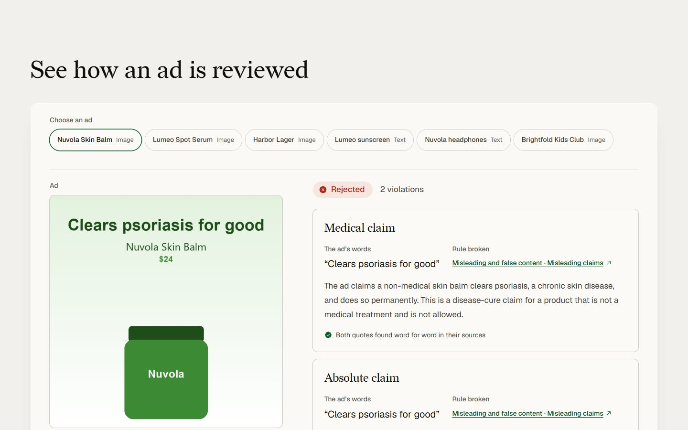
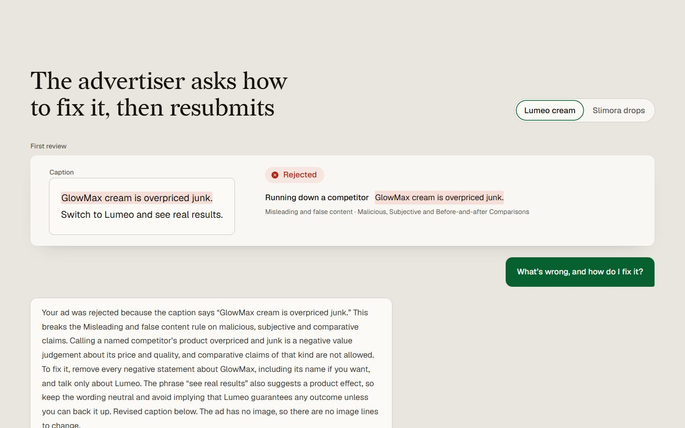
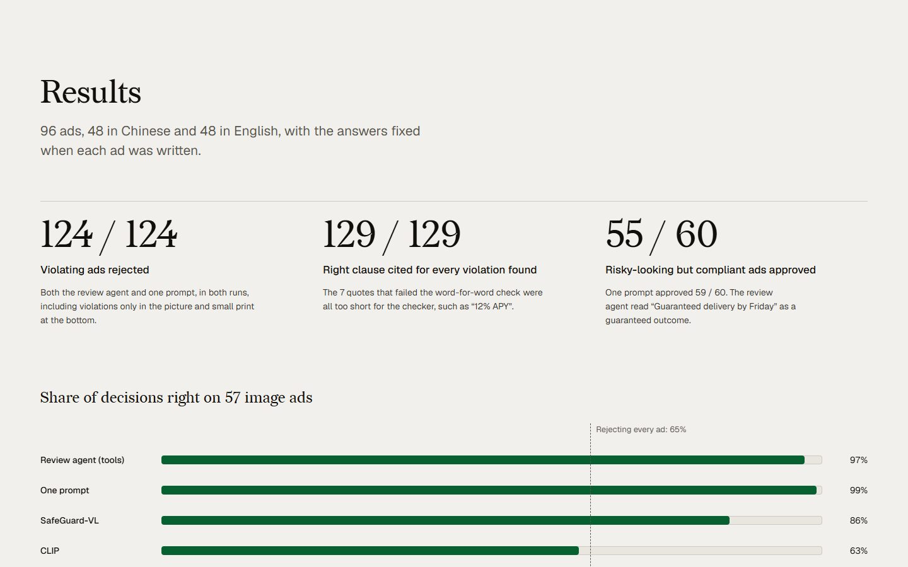

# Grounded Review

An ad-review agent that says which rule an ad breaks and which words break it, and checks every quote it gives before the answer counts. The project also includes a preregistered evaluation against simpler ways of doing the same job.

[中文说明](README.zh-CN.md)



| Review | Fix and resubmit | Results |
|---|---|---|
|  |  |  |

**[Live demo](https://jason-d-e.github.io/grounded-review/en.html)** · [中文演示](https://jason-d-e.github.io/grounded-review/). The page shows stored results and calls no model.

## Where this fits

Grounded Review belongs to a set of projects built on one idea: an AI should show its evidence.

- **Scenario: judgment.** Other projects in the set answer questions from documents, generate images with text, or run voice conversations. This one makes a call on an ad and backs it with the ad's own words and the clause's own words.
- **Checking tool: [evidence-check](https://github.com/Jason-d-e/evidence-check).** Every ad quote and every clause quote in an answer goes through evidence-check's script. A quote that is not word for word in the ad or in the cited clause is caught before anyone reads the answer.
- **Core of the [evidence-backed labelling pipeline](https://github.com/Jason-d-e/grounded-labelling-pipeline).** The pipeline sends incoming ads through this agent, checks the quotes, routes failed checks and uncertain calls to a review queue, and turns reviewed ads into new test items.

## What it does

- **Review.** It reads the ad's caption and image (OCR), looks up clauses in a policy library, and returns approve or reject. Each violation comes with a category, the clause, the offending words, and the clause text.
- **Advise and re-review.** When the advertiser asks what is wrong and how to fix it, it explains, writes a corrected version, and reviews the advertiser's own revision.
- **Remember.** Confirmed decisions are stored. For a new ad, the agent is shown the most similar earlier decisions and the same advertiser's recent ones, so the same claim gets the same call; the clauses still decide when the ad differs. The model only reads the store.
- **Two jurisdictions.**
  - Chinese ads are reviewed against the PRC Advertising Law (2021) and the national regulator's 2023 enforcement guide on absolute terms.
  - English ads are reviewed against the global sections of five TikTok advertising policy pages.
  - The library has 32 clauses, cut from the official texts by script.

## How it was evaluated

Two model arms use the same model, the same categories and the same output format: one prompt that is given everything at once, and the agent with tools. The plan, expectations and file hashes were frozen before each run ([`eval/PREREGISTRATION.md`](eval/PREREGISTRATION.md)). The full report is [`eval/EVALUATION.md`](eval/EVALUATION.md). The product plan, with who it is for, metrics, rollout and risks, is [`product/PRD.md`](product/PRD.md).

| Set | What it is | One prompt | Agent |
|---|---|---|---|
| Held-out | 96 synthetic text and image ads, 30 of them traps; answers fixed when the ads were written | 191/192 decisions right | 187/192 |
| Harder | 24 synthetic ads: long captions, video frames, implied claims | 48/48 | 48/48 |
| Real, English | 30 published rulings of the UK Advertising Standards Authority, 7 of them "not upheld" | 49/60 | 51/60 |
| Real, Chinese | 16 published cases: 12 penalised by market regulators, 4 found lawful by a regulator or a court | 27/32 | 26/32 |

What the numbers say:

- **On written ads both arms reach the ceiling.** On real ads they come off it, but they stay close; where they differ, the agent is stricter.
- **Most remaining errors come from rules, not from reading.** A regulator judges under its own code, which differs from the policy library. Three UK alcohol ads that the regulator cleared, for example, lack the strength statement that TikTok's alcohol policy requires.
- **Quotes hold up.** On the held-out set, 98% of ad quotes and all but one of 425 clause quotes passed the checker. The ad quotes that failed were real words too short for the checker.
- **The agent costs more.** It is 2.2 times the price of one prompt on the held-out set, and 2.4 to 3.1 times on the real ads.
- **Simpler methods fall short.** A banned-word list, zero-shot CLIP and SigLIP 2, and open guardrail models (SafeGuard-VL-RL, Qwen3Guard, Granite Guardian) were also run. None of them gives a clause or a quote. On the held-out set, only SafeGuard-VL-RL (images) and Granite Guardian (text) did better than always rejecting.
- **Memory settled a grey case and never misled.** On 24 new ads, each run three times, the agent was right in 69 of 72 runs without memory and 72 of 72 with it. The difference is one ad, a next-day delivery guarantee that the agent alone rejects every time. On 12 ads where the earlier decision should not be applied, the earlier decision was repeated in 0 of 36 runs. A review with memory cost 0.89 times a review without.
- **The advice step was tested version by version.** v1.1 removed template placeholders from rewrites: 3 of 24 had them, then 0. v1.3 fixed corrected copy written into the wrong field: 6 of 36, then 0. v1.2 did not help and was not adopted.

## Run it

Python 3.11 or later.

```
pip install -r requirements.txt                              # the open-model baselines also need requirements-baselines.txt
python -m unittest discover -s tests -v                      # offline checks, no API calls
python testset/load.py                                       # validate the test set
AD_REVIEW_ENV_FILE=path/to/.env python eval/run.py --split test --repeat 2 --out my-run --batch
python eval/score.py eval/results/my-run.jsonl --split test --out eval/results/my-run.summary.md
AD_REVIEW_ENV_FILE=path/to/.env python eval/run.py --split memory --arms agent,agent_memory --version v1.3 --repeat 3 --out my-memory-run --batch
python eval/memory_report.py eval/results/my-memory-run.jsonl               # the agent without and with memory
```

- **API key.** It is read only from the file named in `AD_REVIEW_ENV_FILE`. `--batch` sends requests through the Message Batches API at half price.
- **evidence-check.** Clone [evidence-check](https://github.com/Jason-d-e/evidence-check) next to this folder, or set `EVIDENCE_CHECK_SCRIPT` to its `check_evidence.py`.
- **English ads need the TikTok pages.** Save each page listed in `policies/build_sources.py` as Markdown in `policies/raw/`, then run `python policies/build_sources.py`. Chinese ads run without them.
- **Word lists.** The word-list baseline needs the files listed in `third_party/README.md`.

## Not included

These are linked, not copied:

- the TikTok policy text;
- the word lists used by the word-list baseline;
- the regulator rulings and case reports behind the real ads. [`testset/real-sources.md`](testset/real-sources.md) gives the selection rules, counts and source pages.

## Files changed for publication

The tables of file hashes in `eval/PREREGISTRATION.md` refer to the files as they were run. For this
copy, `agent/common.py`, `policies/library.py`, `policies/build_sources.py`, `testset/load.py`,
`eval/run.py`, `eval/multiturn.py`, `agent/memory.py`, `tests/test_offline.py` and five files in `baselines/` differ only
in default paths, a comment, and skipping the TikTok pages when they are absent. In the result files,
TikTok policy text is replaced by the clause id and a link to the page.
