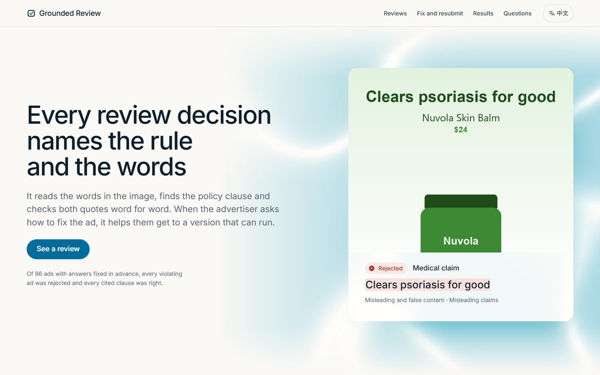
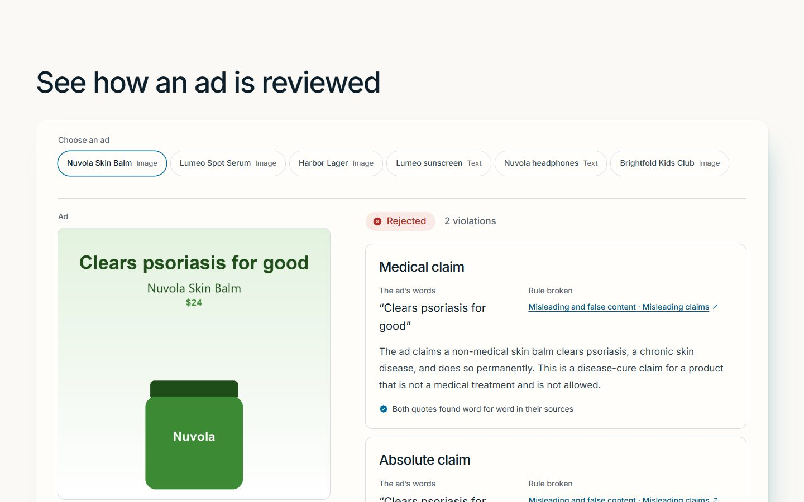
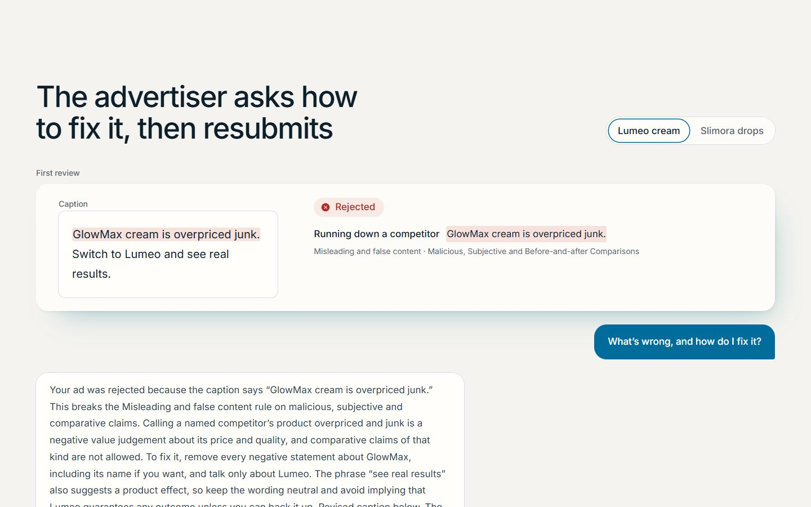
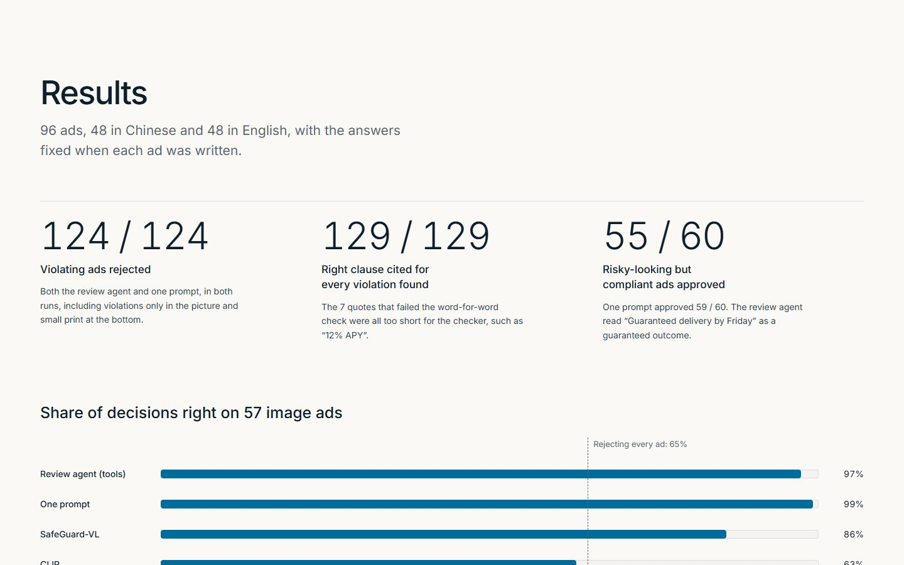

# 有据审核

一个审核广告的 Agent：说得出广告违反了哪一条、是哪几个字违反的，并且每段引文都要先核对通过才算数。项目里还有一套预注册的评测，和更简单的做法比较。

[English](README.md)



| 审核 | 改稿再提交 | 测试结果 |
|---|---|---|
|  |  |  |

截图是演示页的英文版。

## 在整套项目里的位置

有据审核属于一组围绕同一个想法做的项目：AI 要拿出证据。

- **场景：判断类。** 同一组里，别的项目做的是按文档回答问题、生成带字的图片、语音对话。这一个是对一条广告下判断，并用广告原话和条款原文作依据。
- **核对工具：[有据可查 evidence-check](https://github.com/Jason-d-e/evidence-check)。** 回答里的每段广告引文和条款引文，都要过 evidence-check 的脚本。不是逐字出自广告或所引条款的引文，在有人读到回答之前就会被拦下。
- **有据标注流水线的核心**（在做）。流水线把进来的广告交给这个 Agent，核对引文，把核对不过或拿不准的送进复核队列，复核过的广告再变成新的评测题。

## 它做什么

- **审核。** 读广告文案和图片（OCR），在政策库里查条款，给出放行或拒绝。每处违规都附上类别、条款、违规的原话和条款原文。
- **给建议、再复审。** 广告主问哪里违规、怎么改时，它解释原因、写出修改后的版本，再审广告主自己改的版本。
- **两套规则。**
  - 中文广告按《广告法》（2021 修正）和市场监管总局 2023 年的《广告绝对化用语执法指南》审。
  - 英文广告按 TikTok 五个广告政策页面里的全球通用部分审。
  - 政策库共 32 条，由脚本从官方原文截取。

## 怎么评测的

两组模型用同一个模型、同一套类别、同一种输出格式：一组是把所有材料一次交给模型的单个提示词，一组是带工具的 Agent。每次跑之前，都先把计划、预期和文件哈希冻结（[`eval/PREREGISTRATION.md`](eval/PREREGISTRATION.md)）。完整报告见 [`eval/EVALUATION.md`](eval/EVALUATION.md)（英文）。

| 题目 | 是什么 | 单个提示词 | Agent |
|---|---|---|---|
| 留出集 | 96 条自己写的图文广告，其中 30 条陷阱；答案在写题时定好 | 判对 191/192 | 187/192 |
| 难题集 | 24 条自己写的广告：长文案、短视频截图、暗示性说法 | 48/48 | 48/48 |
| 真实广告，英文 | 英国广告标准局（ASA）公开的 30 份裁决，其中 7 份判“不违规” | 49/60 | 51/60 |
| 真实广告，中文 | 16 个公开案例：12 个被市场监管部门处罚，4 个被监管部门或法院认定合法 | 27/32 | 26/32 |

这些数字说明：

- **自己写的题，两组都到顶。** 换成真实广告后不再满分，但两组仍然接近；不一样的地方，是 Agent 更严。
- **剩下的错大多来自规则不同，不是看错了广告。** 监管机构按自己的规则判，和政策库不完全一样。比如英国判不违规的三条酒类广告，没写 TikTok 酒类政策要求的酒精度说明。
- **引文站得住。** 留出集上，98% 的广告引文和 425 段条款引文里的 424 段通过了核对。没通过的广告引文都是原文，只是短于脚本接受的长度。
- **Agent 更贵。** 留出集上是单个提示词的 2.2 倍，真实广告上是 2.4 到 3.1 倍。
- **更简单的做法都不够。** 违禁词表、零样本 CLIP 和 SigLIP 2、开源审核模型（SafeGuard-VL-RL、Qwen3Guard、Granite Guardian）也都跑了，它们都不给条款和原话。留出集上，只有 SafeGuard-VL-RL（图片）和 Granite Guardian（文字）比“全部拒绝”好。
- **改写建议一版一版测过。** v1.1 去掉了改写里留下的模板占位符：24 段里从 3 段降到 0。v1.3 修好了“修改后的文案”写错位置：36 段里从 6 段降到 0。v1.2 没用，没有采用。

## 怎么运行

需要 Python 3.11 或更新版本。

```
pip install -r requirements.txt                              # 开源模型对比组另装 requirements-baselines.txt
python -m unittest discover -s tests -v                      # 离线自检，不调用接口
python testset/load.py                                       # 校验测试集
AD_REVIEW_ENV_FILE=path/to/.env python eval/run.py --split test --repeat 2 --out my-run --batch
python eval/score.py eval/results/my-run.jsonl --split test --out eval/results/my-run.summary.md
```

- **密钥**：只从 `AD_REVIEW_ENV_FILE` 指定的文件读。`--batch` 走批量接口（Message Batches API），价格减半。
- **evidence-check**：把 [evidence-check](https://github.com/Jason-d-e/evidence-check) 克隆到这个文件夹旁边，或者用 `EVIDENCE_CHECK_SCRIPT` 指向它的 `check_evidence.py`。
- **英文广告需要 TikTok 政策页**：把 `policies/build_sources.py` 里列的每一页存成 Markdown 放进 `policies/raw/`，再运行 `python policies/build_sources.py`。中文广告不需要。
- **违禁词表**：违禁词表对比组需要的文件见 `third_party/README.md`。

## 没有收录的

下面这些只放链接，不收录原文：

- TikTok 政策原文；
- 违禁词表对比组用的词库；
- 真实广告题背后的监管裁决和案例报道。选题规则、数量和来源页见 [`testset/real-sources.md`](testset/real-sources.md)。

## 为公开改过的文件

`eval/PREREGISTRATION.md` 里的文件哈希，对应的是当时实际运行的文件。这份公开版里，`agent/common.py`、`policies/library.py`、`policies/build_sources.py`、`testset/load.py`、`eval/run.py`、`eval/multiturn.py`、`tests/test_offline.py` 和 `baselines/` 下的 5 个文件，只改了默认路径和一行注释，并在缺少 TikTok 政策页时跳过相关内容。结果文件里的 TikTok 政策原文，换成了条款编号和页面链接。
